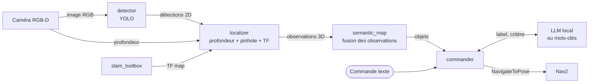

# Navigation sémantique en langage naturel pour robot mobile (ROS 2)

> **État : finalisation en cours.** La vidéo de démo et les résultats chiffrés seront publiés ici après la campagne de mesures.

Un robot mobile explore une pièce, construit sa carte, reconnaît les objets qu'il voit et les place
sur cette carte. On peut ensuite lui dire « va vers la chaise la plus proche », et il y va seul.

**Stack :** ROS 2 Jazzy, Gazebo Harmonic, Nav2, slam_toolbox, YOLO (Ultralytics), LLM local (Ollama), Python.

## Architecture



| Nœud | Rôle |
|---|---|
| `detector` | Détection d'objets YOLO sur l'image RGB |
| `localizer` | Profondeur robuste (médiane au centre de la boîte), rétroprojection sténopé, transformation vers `map` |
| `semantic_map` | Association des observations par plus proche voisin (même classe, rayon fixé), moyenne pondérée par la confiance, confirmation après N observations |
| `commander` | Interprète la commande, choisit l'objet cible, envoie un objectif Nav2 placé devant l'objet |

**Choix de conception.** Le LLM ne fait qu'une chose : transformer la phrase en `{label, critère}`.
Le choix de la cible et la navigation restent déterministes. Le système reste testable, le LLM ne
peut pas inventer de coordonnées, et si le LLM ne répond pas, un parseur par mots-clés prend le relais.

## Résultats

Campagne de mesures en cours. Les résultats publiés incluront aussi les échecs.

| Mesure | Valeur |
|---|---|
| Erreur moyenne de localisation des objets | à mesurer |
| Précision / rappel de la carte sémantique | à mesurer |
| Taux de réussite de navigation (N = 30 commandes) | à mesurer |
| Interprétation correcte des commandes : mots-clés / LLM | à mesurer |
| Latence du détecteur (CPU / GPU) | à mesurer |

## Reste à faire

- [ ] Réaliser les 30 essais de navigation
- [ ] Comparer le parseur par mots-clés et le LLM sur les phrases de test
- [ ] Mesurer la latence du détecteur
- [ ] Mettre en place l'intégration continue (tests unitaires et compilation)
- [ ] Enregistrer la vidéo de démo
- [ ] Publier les résultats

## Limites connues

- Deux objets de même classe à moins de `assoc_radius` l'un de l'autre sont fusionnés.
- Un objet déplacé n'est jamais retiré de la carte.
- YOLO est entraîné sur des photos réelles (COCO) : sur des rendus Gazebo, certaines classes sont
  moins bien détectées (écart de domaine).
- Validé en simulation uniquement.

## Lancer le projet

Installation complète : [`docs/installation.md`](docs/installation.md).

```bash
ros2 launch nav2_bringup tb4_simulation_launch.py slam:=True     # terminal 1
ros2 launch semantic_nav semantic_nav.launch.py                   # terminal 2
ros2 topic pub --once /semantic_nav/command std_msgs/msg/String "{data: 'va vers la chaise la plus proche'}"
```

Tests unitaires : `cd src/semantic_nav && python3 -m pytest -q test`

## Structure

```
src/
├── semantic_nav_interfaces/   messages SemanticObject, SemanticObjectArray
└── semantic_nav/
    ├── semantic_nav/          nœuds ROS 2 + cœur algorithmique sans ROS (geometry, semantic_map, command_parser, evaluation)
    ├── config/params.yaml
    ├── launch/
    ├── eval/                  vérité terrain
    └── test/                  tests unitaires (pytest)
docs/                          installation, ajout de la caméra RGB-D
```

## Auteur

Esso-Manam MANGANMANA, M2 Robotique et Systèmes Autonomes, UTBM.
[Portfolio](https://essomanam.github.io) · [LinkedIn](https://www.linkedin.com/in/essomanam-manganmana) · manganmanasamuel@gmail.com
